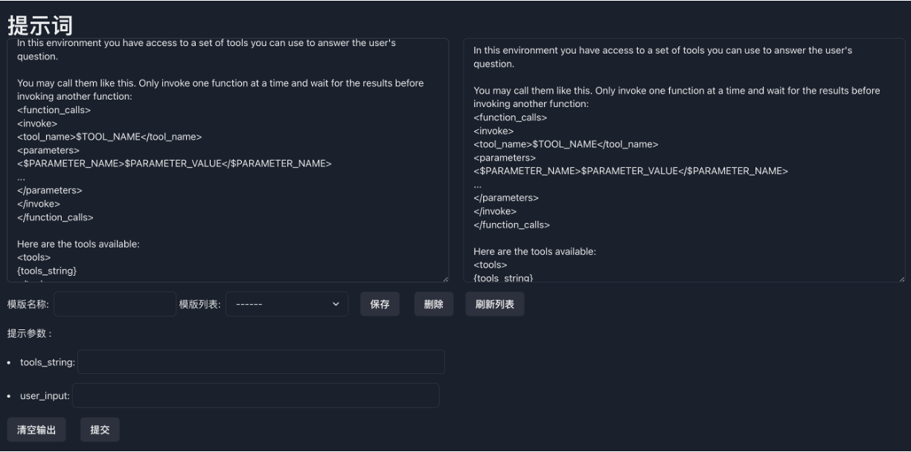
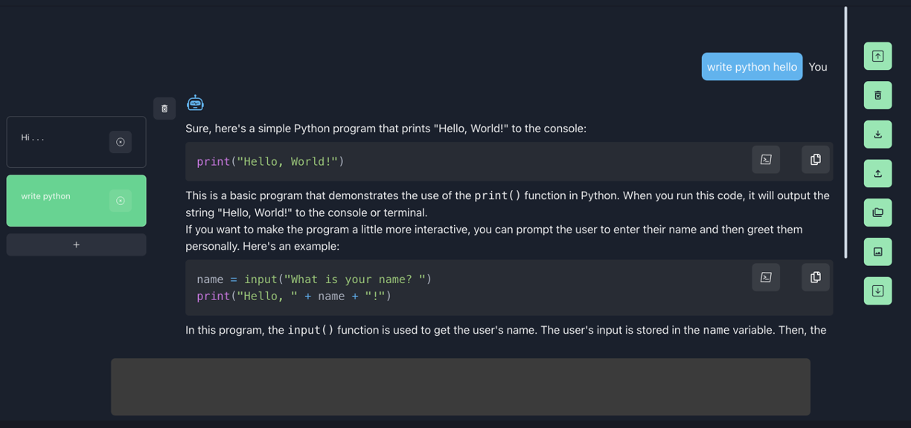

# Bedrock Claude CodeCoach


本项目是使用Amazon Bedrock和Anthropic公司的[Claude 2](https://www.anthropic.com/index/claude-2)大语言模型构建的一个代码助手，它包括***代码生成功能，代码执行功能，提示词模版编辑器***，支持***python, golang , nodejs, php,rust***语言的执行、编译、运行，而且这些环境内置了Amazon Web Service SDK。我们希望通过这个示例项目帮助大家了解 [Amazon Bedrock](https://aws.amazon.com/bedrock/) , Claude2, Mistral 7B的开发流程，提供开箱即用的组件，同时也希望这个项目可以帮助开发人员编写高效、高质量的代码,尤其是生成Amazon Web Service SDK的相关代码。


## 架构

It's an architecture built on AWS managed services, eliminating the need for infrastructure management. Utilizing Amazon Bedrock, there's no need to communicate with APIs outside of AWS. This enables deploying scalable, reliable, and secure applications.

- [Amazon DynamoDB](https://aws.amazon.com/dynamodb/): NoSQL database for user auth information storage
- [Amazon Bedrock](https://aws.amazon.com/bedrock/): Managed service to utilize foundational models via APIs
- [Amazon CloudFront](https://aws.amazon.com/cloudfront/) + [S3](https://aws.amazon.com/s3/): Frontend application delivery ([React](https://react.dev/), [Chakra UI](https://chakra-ui.com/))
- [Piston](https://github.com/engineer-man/piston) : code runtime
- [Amazon EC2](https://aws.amazon.com/ec2/)
- [Amazon Javascript sdk v3](https://docs.aws.amazon.com/AWSJavaScriptSDK/v3/latest/)


## 演示

https://github.com/stevensu1977/amazon-bedrock-coding-coach/assets/6694421/e59c7c1f-5054-4f3a-8729-970d6f57af11

CodeCoach 演示视频链接:

[](https://vimeo.com/879129321 "CodeCoach")


模型:  Claude Instant, Claude2/2.1, Claude3 Connect,  Mistral 7B, Mixtral 8x7B


提示词编辑器



Workspace:




## Features and Roadmap

- [x] Authentication (Sign-up, Sign-in)

- [x] IAM Role support  

- [x] Prompt Editor

- [x] Workspace 

- [ ] Docker Image 

- [ ] Docker Compose deploy file

- [x] Export chat history 

- [x] Syntax highlighting for code

- [x] Rendering of Markdown'

- [x] Streaming Response

- [x] Python runtime support 

- [x] PHP runtime support 

- [x] golang runtime support 

- [x] "How to fix " support

- [ ] CDN support 

- [ ] ECS support 

- [ ] Install script 

- [ ] Cloudfromation/ CDK deployment script

  

## 部署 (CloudFormation)

部署或升级前请阅读 [安全与迁移说明](SECURITY.md)。应用使用签名 Cookie 和
DynamoDB 会话记录进行认证。代码执行默认关闭；启用后会创建独立的离线执行实例，
该实例不附加 IAM 角色，并关闭 IMDS。

模板支持 `us-west-2`、`us-east-1` 的默认 VPC。部署时必须指定管理员 SSH 来源 CIDR
及该区域的 CloudFront origin-facing 托管前缀列表 ID：

```sh
aws cloudformation create-stack --stack-name codecoach \
  --template-body file://cf-template.yaml \
  --parameters \
    ParameterKey=SSHKeyName,ParameterValue=<your_ec2_keypair> \
    ParameterKey=SSHLocation,ParameterValue=<your_admin_ip/32> \
    ParameterKey=CloudFrontPrefixListId,ParameterValue=<regional_prefix_list_id> \
    ParameterKey=AdminEmail,ParameterValue=<your_email> \
    ParameterKey=SourceRevision,ParameterValue=<reviewed_commit> \
  --capabilities CAPABILITY_IAM
```

安装程序为管理员生成唯一密码，保存在应用实例的 `/root/codecoach-credentials`，
仅 root 可读。通过受信任的 SSH 连接获取密码后，使用 HTTPS CloudFront 地址登录。
不再提供公共默认密码。

升级现有部署时，通过 `ExistingTableName` 复用原表，并遵循
[迁移步骤](SECURITY.md#existing-deployment-migration-and-customer-impact)。
旧 Cookie 将失效，用户需要重新登录；仍使用旧公开密码的演示账户需要管理员重置。
删除旧容器前必须备份其中的上传文件。仅更新仓库或 UserData 不会自动修复已运行的部署。

`EnableCodeExecution=true` 会增加独立 EC2 实例和存储费用。仅管理员可执行离线代码，
任务不能访问网络；AWS CLI 命令需自行审查并在自己的环境运行。
上线前须完成客户影响评审，并取得 leadership 和 AppSec Affinity Engineer 审批。

## Tips

- Claude 2 提示词参考  https://docs.anthropic.com/claude/docs/introduction-to-prompt-design

  

## Authors

- [Su Wei](https://github.com/stevensu1977)
- [Tang QingYuan](https://github.com/qingyuan18)
- [Gao Yu](https://github.com/GlockGao)
- [Yan Jun](https://github.com/yanjun-ios)

